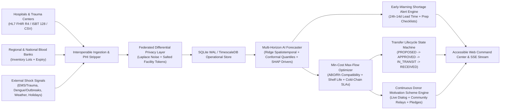

# HemoNet Architecture Blueprint

## 1. End-to-End System Diagram

## 2. Data Schemas & Standards Mapping

### ISBT 128 Mapping
Implemented in `hemonet/domain.py` (`parse_isbt128_payload`, `generate_isbt128_din`):
- `=FACILYYNNNNNN`: Donation Identification Number (DIN) encoding 5-char facility code, 2-digit year, 6-digit sequence.
- `=%XXXX`: ABO/Rh Blood Group code (`9500` -> `O-`, `5100` -> `O+`, `0600` -> `A-`, `6200` -> `A+`, `1700` -> `B-`, `7300` -> `B+`, `2800` -> `AB-`, `8400` -> `AB+`).
- `=<EXXXX`: Component code (`E0306` -> `RBC`, `E3012` -> `PLT`, `E4670` -> `FFP`, `E5100` -> `CRYO`).

### HL7 FHIR R4 Mapping
Implemented in `hemonet/domain.py` (`fhir_bundle_to_inventory_signals`):
- `Organization.id` -> `facility_id`
- `BiologicallyDerivedProduct.productCode.text` + `property[].valueCodeableConcept.text` + `quantity` -> aggregate `(component, blood_type, units)`
- `Appointment` / `Procedure` / `ServiceRequest` -> counted solely into `scheduled_surgical_demand_index`; **patient references and PHI/PII are stripped at ingestion**.

## 3. Security, Privacy & Federated Telemetry Model
- **Zero PHI Storage**: Patient names, MRNs, and clinical notes are never stored or transmitted across the network.
- **Differential Privacy**: Regional aggregate demand telemetry applies clipped Laplace noise (`differentially_private_aggregate`, default $\epsilon = 1.5$) so individual hospital spikes cannot be reverse-engineered.
- **Salted Facility Tokens**: Cross-border analytics reference SHA-256 salted tokens (`anonymize_facility_token`).
- **Clinical Sign-Off Guardrail**: Transfers involving ABO/Rh substitution, cross-border cold-chain customs, or $\ge 12$ units require explicit human clinical sign-off (`requires_clinical_signoff = true`) before leaving `PROPOSED`.

## 4. Offline & Failure Resilience Strategy
- **Local-First Persistence**: SQLite WAL mode ensures hospital inventory syncs, transfer approvals, and donor pledges survive network partitions.
- **Deterministic Safety Fallbacks**: If ML history is sparse (< 5 days for a newly onboarded hospital), `RidgeDemandModel` falls back to safe mean/safety-stock heuristics; the Min-Cost Flow solver enforces hard compatibility and shelf-life bounds deterministically.
- **Zero Single Point of Failure (Production Target)**: Deploy regional stateless API/forecaster pods backed by multi-region Postgres/TimescaleDB + Kafka event logs, with local hospital edge caches capable of 72-hour disconnected operation.

## 5. MVP Rollout Plan
1. **Phase 1 — Metro Cluster Pilot (Months 1–3)**: Connect 5–10 trauma hospitals and 2 regional blood banks via FHIR/CSV; validate 72h shortage recall ($\ge 90\%$) in shadow mode.
2. **Phase 2 — Regional Auto-Matching & Donor Relay (Months 4–6)**: Enable 1-click clinical transfer approvals (`PROPOSED -> APPROVED -> IN_TRANSIT -> RECEIVED`) and public donor motivation dialog.
3. **Phase 3 — National & Cross-Border Federation (Months 7–12)**: Activate differential-privacy federated learning across national registries, air/drone cold-chain SLAs, and customs pre-clearance webhooks.
